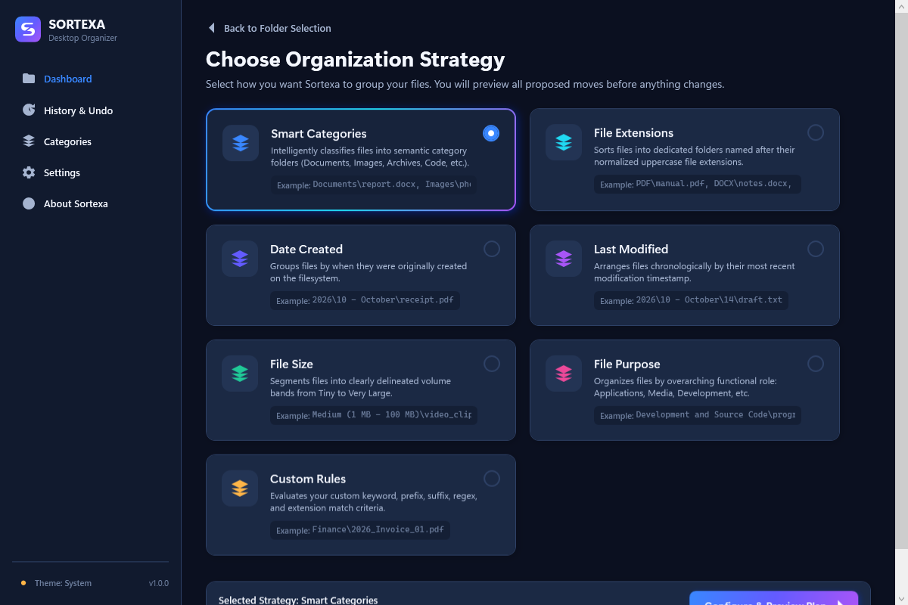
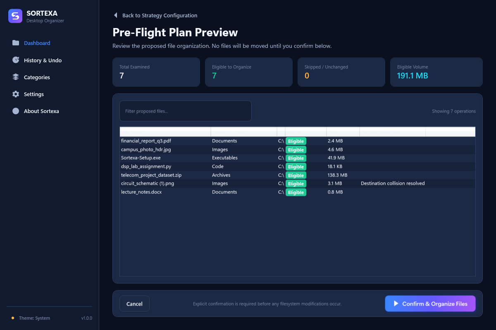
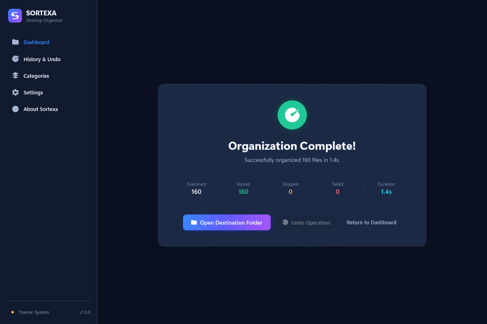
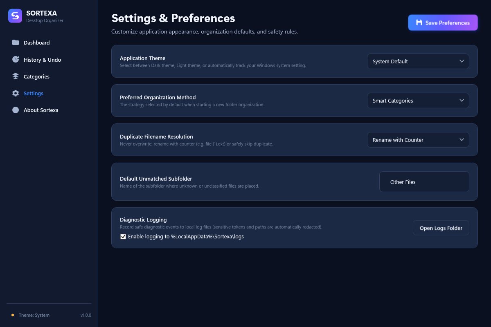

# Sortexa

### Your files. Organized beautifully.

Sortexa is a Windows desktop file organizer built with C# and WPF. It helps you organize cluttered folders using configurable classification methods, with a preview-first workflow designed to keep file operations under your control.

## ✨ Features

- **Smart Categories** — Organize files by their types.
- **Multiple organization methods** — Group files by extension, creation date, modification date, size, purpose, or custom rules.
- **Preview before organizing** — Inspect the proposed file operations before confirming.
- **Safe file handling** — Handle filename collisions without silently overwriting existing files.
- **History & Undo** — Review previous operations and undo supported moves.
- **Customizable categories** — Manage file-extension mappings.
- **Theme support** — Choose the application's available appearance settings.
- **Local-first operation** — Designed to keep file organization and application data on your device.

## 🖥️ Screenshots

### Dashboard


### Choose an organization method


### Preview planned operations


### Operation completion


### Settings


More screenshots are available in the [`screenshots`](screenshots/) directory.

## 🛠️ Technology

- C#
- .NET 10
- Windows Presentation Foundation (WPF)
- Inno Setup
- Automated tests with the project's existing test suite

## 📥 Installation

Download the Windows installer from the **Releases** section of this repository once a release is available.

Run `Sortexa-Setup.exe` and follow the installation instructions.

## 🧑‍💻 Build from source

1. Install the .NET 10 SDK and the Windows desktop development prerequisites.
2. Clone this repository:

   ```powershell
   git clone https://github.com/nikshay-64/Sortexa.git
   cd Sortexa
   ```

3. Open `Sortexa.sln` in Visual Studio or build the solution using the .NET CLI.
4. Run the existing test project to verify the build.

The installer script is available in the [`installer`](installer/) directory.

## 👨‍💻 Developer

**Nikshay Kumar**

Electronics & Telecommunication Engineering  
Dayananda Sagar College of Engineering, Bengaluru

Made with ❤️ - by Nikshay Kumar

## 📄 License

No open-source license has been selected for this repository yet. Unless a license is added, all rights remain with the copyright holder; public visibility does not automatically grant permission to reuse the code.
